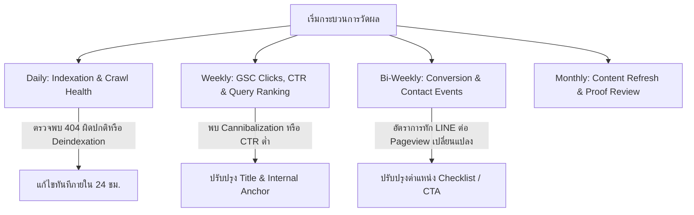

# WMS TRANSPORT — Page-Level SEO Measurement Plan

**Project:** WMS TRANSPORT  
**Production Domain:** `https://wms-transport.com`  
**Document Status:** Ready for Operational Use  
**Current Audit Date:** 10 ตุลาคม 2569 (2026-10-10)  
**Primary Integration Tier:** **Tier -1 (No Google Credentials Configured)**  

---

## 1. Executive Overview & Integration Status

As verified through `skills-seo-google` (`python claude-seo/scripts/google_auth.py --check --json`), the environment is currently operating in **Tier -1 (No credentials configured)**. No active Google Search Console (GSC) API service account keys (`client_secrets.json`) or Google Analytics 4 (GA4) measurement API tokens are installed in this local development workspace.

Therefore, this measurement plan:
1. Formulates the **exact measurement framework**, priority target URLs, and query-to-page mappings.
2. Establishes the **event tracking architecture** for GA4 (preventing double-counting between Next.js SPA router transitions and GA4 Enhanced Measurement).
3. Provides a **reusable manual reporting template** for the business owner/marketing team to log live Search Console and GA4 data during weekly reviews.
4. Outlines the precise credential onboarding steps required to activate automated read-only fetching via the Google SEO skill.

---

## 2. Priority URL Registry & Intent Target Matrix

| Priority URL | Page Role & Category | Target Primary Intent | Target Keywords (Thai) | Baseline Status | Review Interval |
| :--- | :--- | :--- | :--- | :--- | :--- |
| `https://wms-transport.com/` | Homepage / Core Brand Hub | Commercial / Brand | รถกระบะตู้ทึบรับจ้าง, รถรับจ้าง wms | 200 OK / Indexed | รายสัปดาห์ (Weekly) |
| `https://wms-transport.com/pricing` | Evergreen Pricing Overview | Commercial Investigation | ราคารถรับจ้างตู้ทึบ, ค่ารถรับจ้าง | 200 OK / Indexed | ราย 2 สัปดาห์ (Bi-weekly) |
| `https://wms-transport.com/pricing/moving` | Home & Condo Moving Pricing | Commercial / Transactional | ราคาย้ายบ้าน, ค่าจ้างย้ายคอนโด, ค่าคนยกของ | 200 OK / Indexed | ราย 2 สัปดาห์ (Bi-weekly) |
| `https://wms-transport.com/pricing/motorcycle-transport` | Motorcycle Transport Evergreen Hub | Commercial / Transactional | ส่งมอเตอร์ไซค์ไปต่างจังหวัด, ขนส่งบิ๊กไบค์ | 200 OK / Indexed | รายสัปดาห์ (Weekly) |
| `https://wms-transport.com/pricing/motorcycle-2026` | 2026 Seasonal Rate Update Matrix | Seasonal Informational | ตารางค่าขนส่งมอเตอร์ไซค์ 2569, ราคาส่งมอเตอร์ไซค์ 2026 | 200 OK / Indexed | รายเดือน (Monthly) |
| `https://wms-transport.com/service/bkk-thonburi` | Thonburi 15-District Regional Hub | Local Commercial | รถรับจ้างฝั่งธน, รถตู้ทึบฝั่งธนบุรี | 200 OK / Indexed | รายสัปดาห์ (Weekly) |
| `https://wms-transport.com/areas/bkk-thonburi/bang-khae` | Local Evidence Landing Page | Hyperlocal Commercial | รถรับจ้างบางแค, ย้ายคอนโดบางแค เพชรเกษม | 200 OK / Indexed | รายสัปดาห์ (Weekly) |
| `https://wms-transport.com/areas/bkk-thonburi/pinklao` | Local Evidence Landing Page | Hyperlocal Commercial | รถรับจ้างปิ่นเกล้า, ส่งมอเตอร์ไซค์ปิ่นเกล้า | 200 OK / Indexed | รายสัปดาห์ (Weekly) |
| `https://wms-transport.com/areas/samutsakhon/maha-chai` | Local Evidence Landing Page | Hyperlocal Commercial | รถรับจ้างมหาชัย, ส่งสินค้าโรงงานสมุทรสาคร | 200 OK / Indexed | รายสัปดาห์ (Weekly) |
| `https://wms-transport.com/service/phuket/moving` | Corridor Operational Landing Page | Long-Distance Transactional | ย้ายบ้านไปภูเก็ต, รถรับจ้างกรุงเทพ ภูเก็ต | 200 OK / Indexed | ราย 2 สัปดาห์ (Bi-weekly) |
| `https://wms-transport.com/guides/truck-capacity-cbm` | Interactive Educational Guide | Informational / Problem-solving | รถกระบะตู้ทึบกี่คิว, คำนวณ CBM ย้ายบ้าน | 200 OK / Indexed | รายเดือน (Monthly) |
| `https://wms-transport.com/portfolio/moving-condo-bang-khae` | Authenticated Case Study Evidence | Proof / Trust Verification | รีวิวย้ายคอนโดบางแค, ผลงานขนย้าย wms | 200 OK / Indexed | รายเดือน (Monthly) |

---

## 3. Metrics Definitions & Measurement Architecture

### 3.1 Organic Search Performance Metrics (Google Search Console)
* **Impressions (การแสดงผล):** จำนวนครั้งที่ URL ของ WMS TRANSPORT ปรากฏในผลการค้นหาของผู้ใช้ (ทั้ง Mobile และ Desktop)
* **Clicks (การคลิก):** จำนวนครั้งที่ผู้ใช้คลิกผลการค้นหาเข้ามายังเว็บไซต์
* **Average CTR (อัตราการคลิกผ่านเฉลี่ย):** `(Clicks / Impressions) * 100%` วิเคราะห์ความดึงดูดของ Page Title และ Meta Description ในภาษาไทย
* **Average Position (อันดับเฉลี่ย):** อันดับเฉลี่ยของ URL สำหรับคีย์เวิร์ดเป้าหมายในประเทศไทย (ค่าต่ำกว่า = อันดับดีกว่า)

### 3.2 Conversion & Engagement Events (Google Analytics 4)
* **`page_view` (การเปิดหน้าเว็บ):**
  * *Audit Finding:* GA4 Enhanced Measurement เปิดฟังก์ชัน **Page changes based on browser history events** โดยอัตโนมัติ ซึ่งอาจส่งอีเวนต์ซ้ำซ้อนกับ Next.js App Router client navigation (`usePathname`)
  * *Resolution Implemented:* ใน [GoogleAnalytics.tsx](file:///c:/Users/PC/Desktop/work/WMS%20TRANSPORT/src/components/GoogleAnalytics.tsx) ได้เพิ่ม `useRef(true)` สำหรับ initial render เพื่อป้องกันการยิง `page_view` ซ้ำกับ Snippet เริ่มต้น ขณะที่การเปลี่ยนหน้า SPA ภายในจะส่งอีเวนต์เฉพาะเมื่อ URL เปลี่ยนแปลงจริง
* **`contact_click_line` (การคลิกติดต่อผ่าน LINE Official):**
  * เกิดขึ้นเมื่อผู้ใช้คลิกปุ่มเชื่อมต่อไปยัง `https://line.me/ti/p/DtICkMaDet`
  * ติดตามแยกตามตำแหน่ง: `navbar_mobile`, `floating_dock`, `quotation_guide`, `inline_cta`
* **`contact_click_phone` (การคลิกติดต่อทางโทรศัพท์):**
  * เกิดขึ้นเมื่อผู้ใช้กดลิงก์ `tel:0612402436`
  * บันทึกค่าจริงโดยไม่นับรวมการคลิกผิดหรือการกดซ้ำซ้อน
* **`quotation_guide_interaction` (การโต้ตอบกับเช็กลิสต์เตรียมข้อมูล):**
  * ติดตามการกางดูเช็กลิสต์ 5 ข้อในคอมโพเนนต์ `<QuotationPreparationGuide />` เพื่อวัดว่าผู้ใช้ได้รับข้อมูลเตรียมตัวครบถ้วนก่อนทัก LINE หรือไม่

---

## 4. Review Cadence & Operational Intervals



1. **Daily (รายวัน):** ตรวจสอบ Search Console Coverage / Indexation status ว่ามี URL หลุดหรือเกิด Server Error หรือไม่
2. **Weekly (รายสัปดาห์):** บันทึก Clicks, Impressions และ Average Position สำหรับ 12 Priority URLs
3. **Bi-Weekly (ราย 2 สัปดาห์):** เปรียบเทียบ Conversion Rate (Contact Events / Organic Sessions) และแยกประเภทบริการ (ขนย้าย vs ส่งมอเตอร์ไซค์ vs สินค้าโรงงาน)
4. **Monthly (รายเดือน):** ทบทวนหลักฐานรูปถ่ายหน้างานจริงใหม่ๆ จากผู้จัดการฝ่ายปฏิบัติการ เพื่อพิจารณาเปิดเผยแพร่เขตที่ยังติดสถานะ Draft (13 เขตฝั่งธนบุรี)

---

## 5. Manual Tracking & Reporting Template (Tier -1 Active Use)

สำหรับช่วงที่ยังไม่ได้ติดตั้ง Google API Credentials ให้ทีมงานใช้แบบฟอร์มบันทึกข้อมูลรายสัปดาห์นี้:

### บันทึกรอบสัปดาห์: ว/ด/ป: ________________ ถึง ________________

| URL ที่ติดตาม | Clicks (สัปดาห์นี้) | Clicks (สัปดาห์ก่อน) | Imp (สัปดาห์นี้) | Imp (สัปดาห์ก่อน) | CTR (%) | อันดับเฉลี่ย | LINE Clicks | Phone Calls | หมายเหตุ / ฤดูกาล |
| :--- | :---: | :---: | :---: | :---: | :---: | :---: | :---: | :---: | :--- |
| `/` (หน้าแรก) | | | | | | | | | |
| `/pricing` | | | | | | | | | |
| `/pricing/moving` | | | | | | | | | |
| `/pricing/motorcycle-transport` | | | | | | | | | |
| `/pricing/motorcycle-2026` | | | | | | | | | |
| `/service/bkk-thonburi` | | | | | | | | | |
| `/areas/bkk-thonburi/bang-khae` | | | | | | | | | |
| `/areas/bkk-thonburi/pinklao` | | | | | | | | | |
| `/areas/samutsakhon/maha-chai` | | | | | | | | | |
| `/service/phuket/moving` | | | | | | | | | |
| `/guides/truck-capacity-cbm` | | | | | | | | | |
| `/portfolio/moving-condo-bang-khae` | | | | | | | | | |

---

## 6. How to Activate Automated Google SEO Skill Reporting

เมื่อผู้ดูแลระบบหรือเจ้าของธุรกิจพร้อมเชื่อมต่อระบบรายงานอัตโนมัติ ให้ดำเนินการดังนี้:

1. **สร้าง Service Account หรือ OAuth Client ใน Google Cloud Console:**
   * เปิดใช้งาน Google Search Console API และ Google Analytics Data API (v1beta)
   * ดาวน์โหลดไฟล์ Key JSON
2. **จัดเก็บไฟล์ในโฟลเดอร์โครงการ (ห้าม Commit ลง Git):**
   * บันทึกเป็น `claude-seo/client_secrets.json` หรือตั้งค่าพาธในสภาพแวดล้อม
3. **ตรวจสอบสิทธิ์ผ่านคำสั่ง:**
   ```bash
   python claude-seo/scripts/google_auth.py --check --json
   ```
4. **เมื่อได้ผลลัพธ์ Tier 1 หรือ Tier 2:** ระบบจะสามารถดึง Clicks, Impressions, CTR, และ Query Cannibalization รายหน้าได้โดยอัตโนมัติผ่าน `skills-seo-google`
